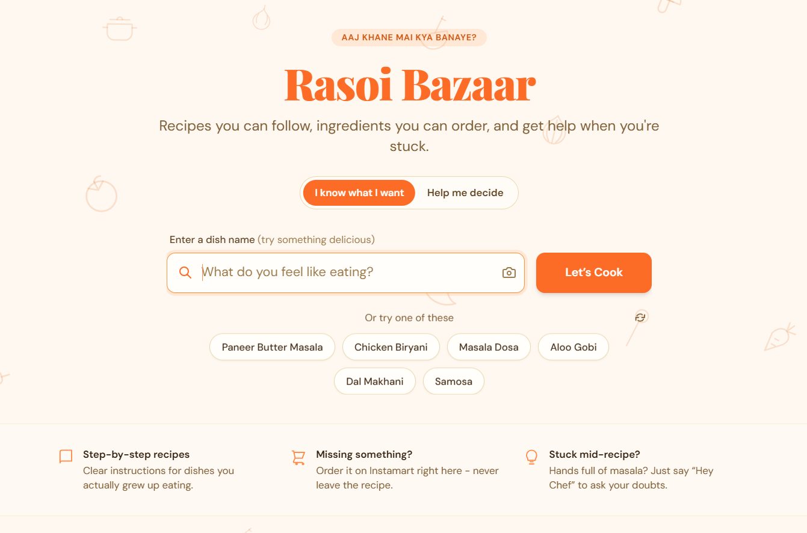

# 🍲 Rasoi Bazaar

Cook real Indian food at home, without the guesswork.

**Live:** [rasoi-bazaar.vercel.app](http://rasoi-bazaar.vercel.app/)

---

## What it does

Rasoi Bazaar is built to make Indian cooking easy for anyone, with recipes that use basic equipment and ingredients you probably already have - no fancy gadgets, no hunting for obscure spices.

- **600+ recipes** - Indian dishes from across regions, explained step by step so you're never left guessing what to do next.

- **Order instead of cook** - Don't feel like making the dish yourself? Order it straight from Swiggy, right inside the app - search, order, and track it, all without switching apps.

- **Missing an ingredient?** - Order it on the spot through Instamart, so a missing item never stops you mid-recipe.

- **An AI cooking companion that actually knows your recipe** - It knows which dish you're making and exactly which step you're on, so you can ask it questions anytime. You can even just tell it "order this for me" and it'll get the ingredient delivered.

- **"Hey Chef" - cook hands-free** - Like talking to Alexa, but for your kitchen. Just say "Hey Chef" and ask your question out loud while your hands are busy cooking.

- **Cook With What You Already Have** - Tell the app what equipment and groceries you have using a simple kitchen canvas, and it'll suggest dishes you can actually make right now.

- **A UI that feels alive** - Each recipe page is tinted to match the dish - a warm brown for rajma chawal, a soft pink for a strawberry dessert, and so on. Add in built-in timers and a clean, easy-to-follow layout, and cooking along feels effortless.

---

## Contributing

1. Fork the repo
2. Create a branch (`feature/your-feature-name`)
3. Commit, push, open a PR

---

## Contact

**Pranav Kohli** - [kohlipranav24@gmail.com](mailto:kohlipranav24@gmail.com)